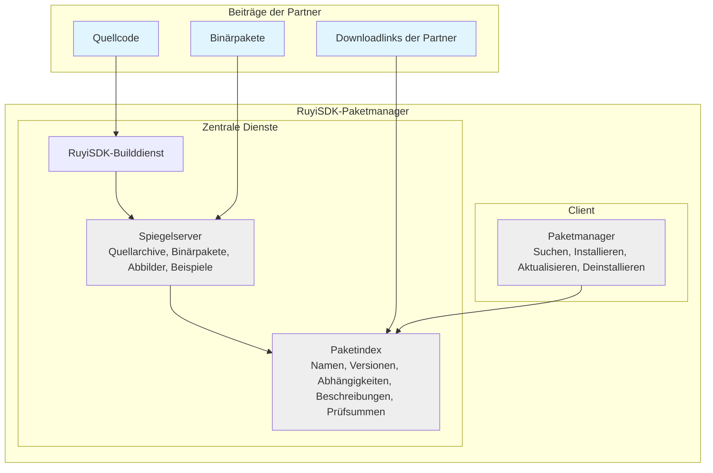

# Leitfaden für RuyiSDK-Partner

Das RuyiSDK-Team lädt Partner ein, zuverlässige Entwicklungsressourcen für das RISC-V-Ökosystem bereitzustellen. Dieser Leitfaden beschreibt die verfügbaren Integrationswege und das Antragsverfahren.

## 1. So funktioniert die Paketverteilung

Mit dem RuyiSDK-Paketmanager können RISC-V-Entwickler Ressourcen zentral finden und verwalten:

- Toolchains mit Compilern, Linkern und Debuggern
- Für RISC-V optimierte Bibliotheken, Frameworks und Laufzeitumgebungen
- Betriebssystemabbilder, Firmware und Gerätetreiber
- Werkzeuge für Leistungsanalyse, Simulation, Verifikation und Tests
- Wichtige Anwendungen, die auf RISC-V portiert wurden
- Lernmaterialien wie Beispielcode, Tutorials und Anwendungsfälle

Vorrang haben Ressourcen, die direkt mit der Entwicklung für RISC-V zu tun haben. Für allgemeine Werkzeuge ohne spezifischen RISC-V-Bezug eignen sich andere Vertriebskanäle besser. Bei Fragen zur Eignung einer Ressource können Sie uns vor der Antragstellung kontaktieren.



- Der [Paketmanager](https://github.com/ruyisdk/ruyi) läuft unter Linux auf x86_64, aarch64 und riscv64. Er kann Pakete suchen, installieren, aktualisieren und deinstallieren. Die [Plattformübersicht](./platform-support.md) nennt unterstützte Distributionen wie Debian, Ubuntu, openEuler, Fedora, Arch Linux und Gentoo.
- Der [Paketindex](https://github.com/ruyisdk/packages-index/) enthält die maßgeblichen Paketnamen, Versionen, Abhängigkeiten, Beschreibungen und Prüfsummen. Der Client findet und lädt anhand dieser Metadaten die zugehörigen Dateien.
- Der [Spiegelserver](https://mirror.iscas.ac.cn/ruyisdk/) stellt die Dateien bereit, darunter Quellarchive, vorkompilierte Pakete, Systemabbilder und Beispiele. Er unterstützt verschiedene Ressourcentypen und Archivformate.

## 2. Integrationsmöglichkeiten

### 2.1 Aus Quellcode bauen

Dieser Weg eignet sich für Open-Source-Projekte für RISC-V. Das RuyiSDK-Team erstellt und verteilt die Pakete.

1. Stellen Sie den vollständigen Quellcode bereit und erläutern Sie die Unterstützung oder Optimierungen für RISC-V.
2. Erteilen Sie dem RuyiSDK-Team die Erlaubnis, den Quellcode zu bauen und die Binärpakete über seine offiziellen Kanäle zu verteilen.
3. Das Team kompiliert, paketiert und testet die Software entsprechend den Anforderungen des Projekts und Ihren Empfehlungen.
4. Das Team lädt die Binärpakete auf den offiziellen Spiegelserver hoch und trägt deren Metadaten in den Paketindex ein.

Dieser Weg bietet sich für Projekte ohne eigenen Vertriebskanal an. Build-Skripte oder Hinweise zur Paketierung helfen dabei, das vorgesehene Verhalten des Projekts zu erhalten.

### 2.2 Vorkompilierte Pakete verteilen

Diese Möglichkeit ist für RISC-V-Software mit einem etablierten Veröffentlichungsprozess oder ohne verfügbaren Quellcode gedacht. Sie können wählen, wo die Binärpakete bereitgestellt werden.

#### Option A: RuyiSDK-Spiegelserver

1. Liefern Sie getestete Binärpakete und nennen Sie die unterstützten Architekturen und kompatiblen Distributionen.
2. Erteilen Sie dem RuyiSDK-Team die Erlaubnis, die Pakete weiterzuverteilen.
3. Das Team lädt die Dateien auf den offiziellen Spiegelserver hoch und prüft die grundlegende Kompatibilität.
4. Das Team veröffentlicht die Downloads auf dem offiziellen Spiegelserver und trägt die Metadaten in den Paketindex ein.

#### Option B: Downloads auf eigenen Servern

Sie behalten die Kontrolle über die Binärdateien. RuyiSDK hilft beim Auffinden und Installieren der Pakete.

1. Geben Sie dem RuyiSDK-Team öffentliche Downloadlinks für Ihre Pakete.
2. Ihre Server müssen anonyme HTTP- und HTTPS-Anfragen mit dem Header `User-Agent: ruyi/<version>` zulassen, wie bei `wget` oder `curl`. Downloads dürfen keine interaktive Anmeldung oder komplexe Authentifizierung erfordern.
3. Das Team trägt Metadaten und Downloadlinks in den Index ein. Der Paketmanager lädt die Dateien direkt von Ihren Servern herunter.

Als Betreiber sind Sie für die Pflege der Binärdateien und Metadaten verantwortlich:

- Halten Sie Downloadlinks dauerhaft erreichbar. Versionierte Pfade oder inhaltsadressierte URLs bleiben auch bei Änderungen der Website oder Verzeichnisstruktur gültig.
- Aktualisieren Sie den Paketindex bei jeder Veröffentlichung. Halten Sie Versionsnummern, Prüfsummen und Änderungsprotokolle aktuell.
- Falls eine unvermeidbare Änderung einen Link ungültig macht, reichen Sie innerhalb von **48 Stunden** ein Issue oder einen Pull Request zur Aktualisierung des Index ein.
- Stellen Sie die Kompatibilität mit den angegebenen Plattformen und Architekturen sicher. Passen Sie die Angaben an, wenn sich die unterstützten Umgebungen ändern.
- Wählen Sie diesen Weg nur, wenn Sie das Paket voraussichtlich mindestens **sechs Monate** pflegen können.

Sie können Paketdefinitionen nach den Vorgaben des [Paketindex](https://github.com/ruyisdk/packages-index) direkt per Pull Request einreichen. Der Index lässt sich auch automatisch aus dem CI/CD-Veröffentlichungsprozess aktualisieren.

## 3. Antrag und Zusammenarbeit

### Schritt 1: Antrag einreichen

Wenn Sie den gewünschten Integrationsweg kennen und mit GitHub vertraut sind, eröffnen Sie ein Issue im [Paketindex](https://github.com/ruyisdk/packages-index) mit diesen Angaben.

```markdown
## Antrag auf Integration einer Ressource

### Allgemeine Informationen
- Name der Ressource:
- Aktuelle Version:
- Projektwebsite oder Repository:
- Lizenz:
- Integrationsweg: □ Aus Quellcode bauen □ RuyiSDK-Spiegelserver □ Eigene Server

### Technische Informationen
- Unterstützte Architekturen: □ x86_64 □ aarch64 □ riscv64
- Unterstützte Distributionen oder Umgebungen:
- Ressourcentyp: □ Toolchain □ Bibliothek □ Entwicklungswerkzeug □ Systemabbild □ Sonstiges (bitte angeben)

### Angaben zum gewählten Integrationsweg

#### Aus Quellcode bauen
- Quellcode-Repository:
- Build-Abhängigkeiten:
- Besondere Build-Schritte und Hinweise:
- □ Ich vertrete den Rechteinhaber und erlaube dem RuyiSDK-Team, aus diesem Quellcode Binärpakete zu erstellen und zu verteilen.

#### RuyiSDK-Spiegelserver
- Downloadadresse oder Übergabeverfahren:
- SHA-256-Prüfsumme:
- Getestete Plattformen:
- □ Ich vertrete den Rechteinhaber und erlaube dem RuyiSDK-Team, die Binärpakete weiterzuverteilen.

#### Eigene Server
- URL-Muster für stabile Versionen (mit einer Variablen wie {version} möglich):
- Pakete für mehrere Architekturen: □ Ja □ Nein
- □ Der Server akzeptiert anonyme HTTP- oder HTTPS-Anfragen mit einem User-Agent-Header.
- □ Ich akzeptiere die Wartungsanforderungen und halte die Downloadlinks erreichbar.

### Kontakt
- Name oder Team:
- E-Mail:
- Weitere Kontaktmöglichkeiten (optional):
```

Wenn Sie Fragen zum passenden Integrationsweg oder zur Eignung Ihrer Ressource haben, schicken Sie eine kurze Beschreibung an [contact@ruyisdk.cn](mailto:contact@ruyisdk.cn?subject=RuyiSDK%20Resource%20Integration). Wir melden uns innerhalb von drei Werktagen und helfen bei den nächsten Schritten.

### Schritt 2: Technik und Genehmigungen abstimmen

1. Das RuyiSDK-Team prüft den RISC-V-Bezug und die technische Machbarkeit.
2. Der Partner legt die erforderliche Genehmigung oder Erklärung vor.
3. Beide Teams stimmen die technischen Details ab.

### Schritt 3: Integrieren und veröffentlichen

Wir integrieren, testen und veröffentlichen die Ressource über den gewählten Vertriebsweg.

Partner mit eigenen Downloadservern können den Paketindex auch direkt forken und einen Pull Request einreichen. Damit die Integration schneller erfolgt, bearbeitet das RuyiSDK-Team diese Beiträge vorrangig.

Wir freuen uns auf die Zusammenarbeit am RISC-V-Entwicklungsökosystem.
