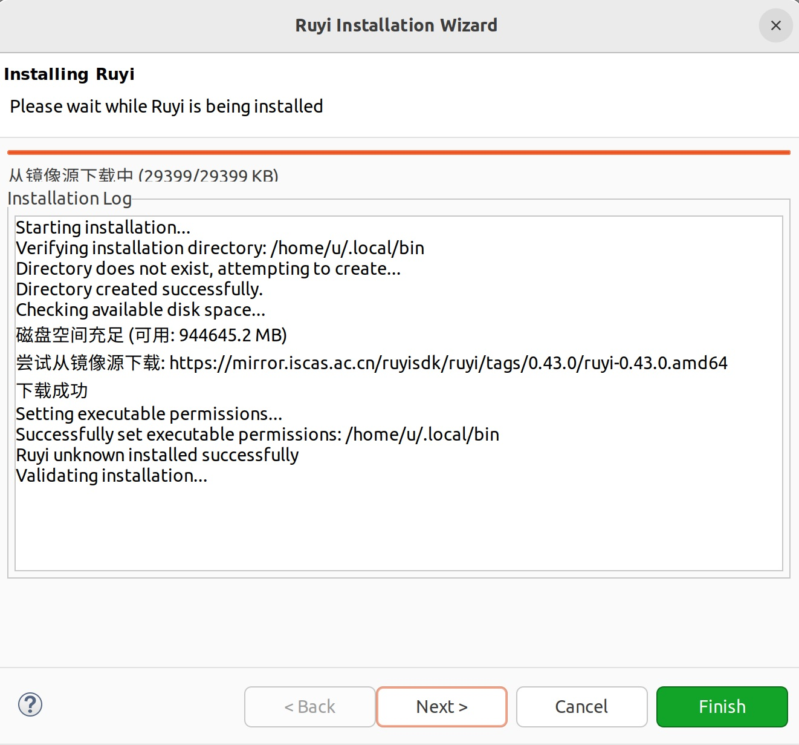
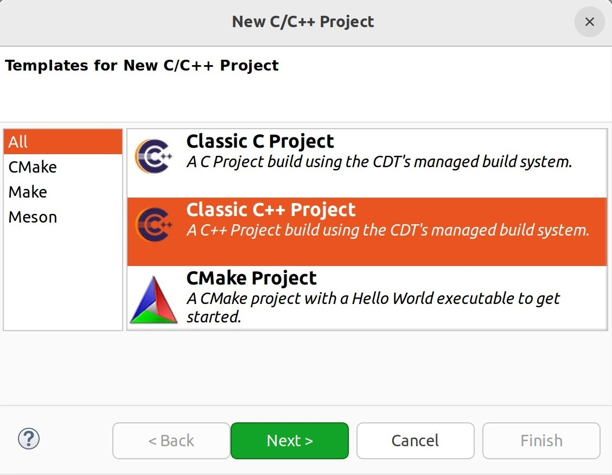
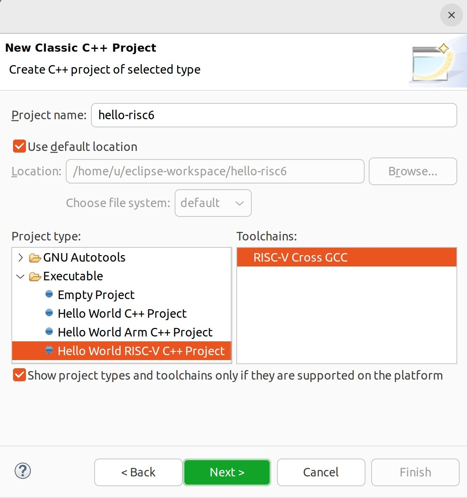
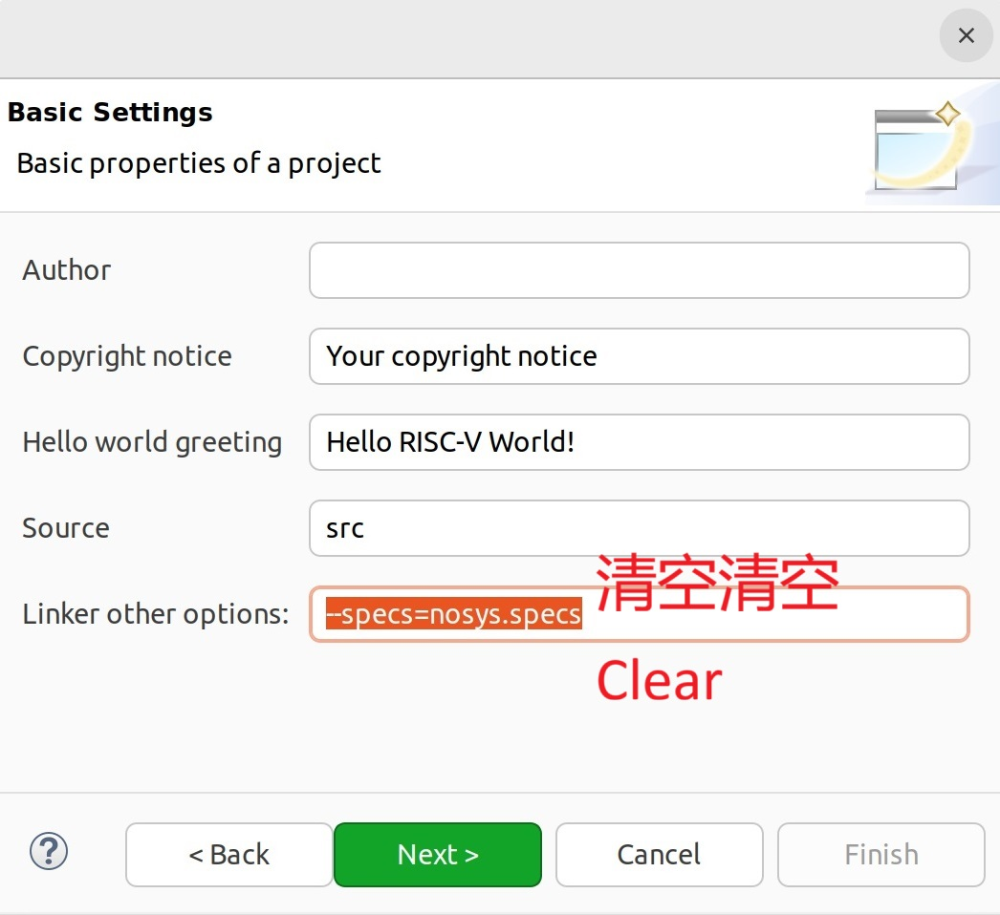
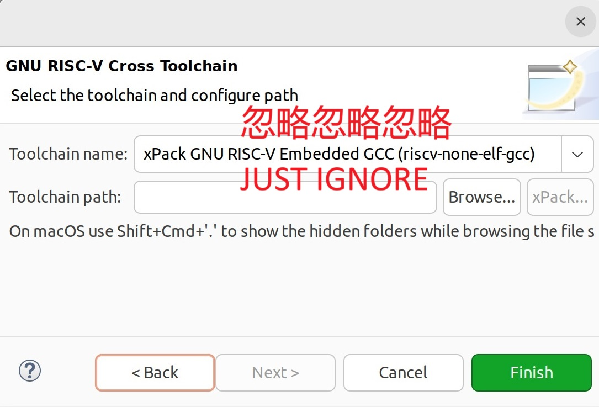
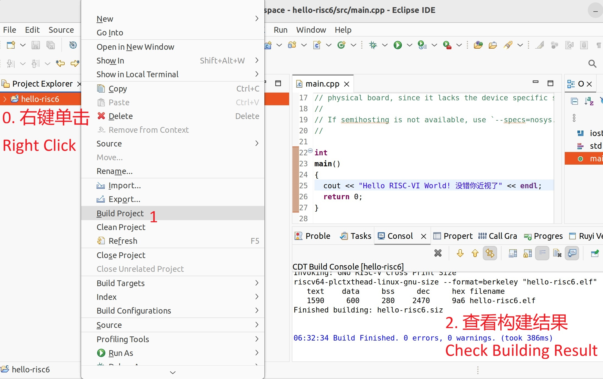

# Build and Debug Hello World on Sipeed Lichee Pi 4A with RuyiSDK IDE

## Test Environment

- Operating system: Ubuntu 24.04 x86_64
- IDE: Eclipse IDE for Embedded C/C++ Developers 2026-06 (4.40.0)

## Installing the RuyiSDK Package Manager via IDE

Launch the IDE, expand the top menu bar "RuyiSDK", and click "Ruyi Installation" to open the installation wizard. Follow the instructions to complete the setup. After installation, expand the "File" menu and click "Restart" to restart the IDE.

## Creating a C/C++ Project in the IDE

Launch the IDE, expand the top menu bar "File"- "New", and in the "C/C++ Project" window click the "Classic C++ Project" wizard.

On the "New Classic C++ Project" page, under "Project type", select "Executable" – "Hello World RISC-V C++ Project", and under "Toolchains" choose "RISC-V Cross GCC".

Clear the linker parameters provided in the "Basic Settings" page under "Linker other options".

On the "GNU RISC-V Cross Toolchain" page, no configuration is required—simply click "Finish".

You can skip building the project for now.

## Creating a Virtual Environment for the New Project

In **Project Explorer**, right-click the project and choose **RuyiSDK → New Venv...**. In **New virtual environment**, select `sipeed-lpi4a` under **Profiles** and the latest `gnu-plct-xthead` under **Toolchains**. Select **Enable** next to **Emulators** and pick the latest `qemu-user-riscv-xthead`. Click **Finish** and wait for the IDE to create the environment.

## Applying the Virtual Environment and Building the Project

In **Project Explorer**, right-click the project and choose **RuyiSDK → Apply Venv...**. Select a virtual environment and click **OK**.

Note the names of the Run and Debug configurations in the confirmation dialog.

In "Project Explorer", right‑click the project and click "Build Project".

The project builds successfully, generating an executable file with the ".elf" extension.

## Running and Debugging with QEMU

### Run

Click the arrow next to the green Run button in the toolbar and choose **Run Configurations...**. Expand **C/C++ Application** and choose the entry for your project and virtual environment. Click **Run** to start the program.

The program runs successfully.

### Debug

Click the arrow next to the green Debug button and choose **Debug Configurations...**. Expand **C/C++ Remote Application** and select the entry for your project and virtual environment. Click **Debug** to start debugging.

The debugger displays threads, stack frames, and data types.
