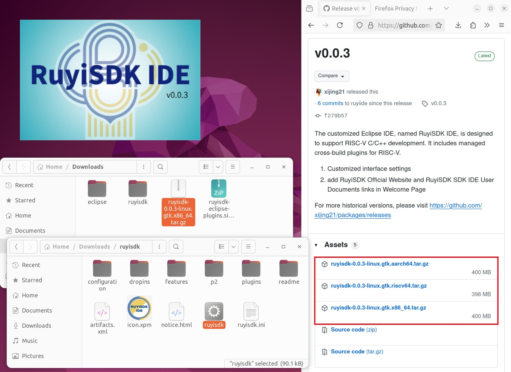
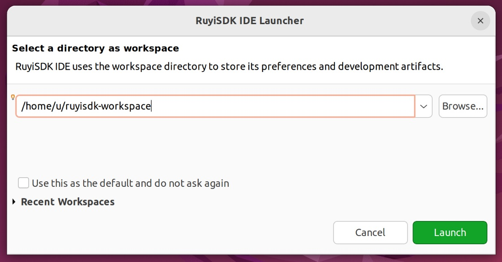
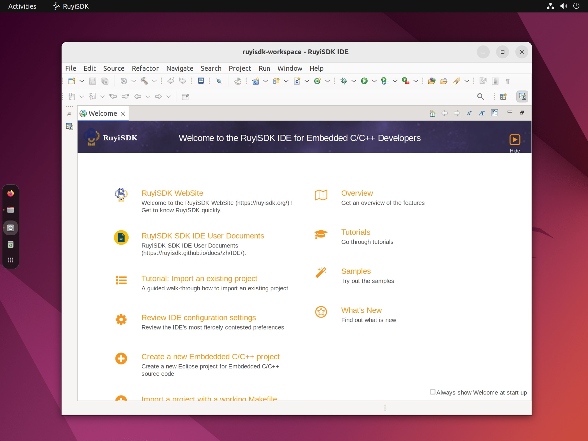

# Overview

## Introduction

RuyiSDK IDE is a graphical integrated development environment built on the open-source Eclipse Embedded CDT, primarily designed for RISC-V developers. The tool inherits Eclipse’s strong support for embedded development and is planned to gradually integrate SDKs for multiple mainstream RISC-V development boards, establishing a RuyiSDK‑featured RISC-V development environment that benefits software developers.

## Download

RuyiSDK IDE download address:  https://fast-mirror.isrc.ac.cn/ruyisdk/ide/0.0.3/ (Do not remove the trailing slash)

This IDE supports three architectures: x86_64, aarch64, and riscv64. Please select according to your current development environment. The IDE already includes a JRE, so you do not need to configure a separate Java environment.

## Launch

1. Extract the tar.gz  package, then double‑click `ruyisdk` in the extracted ruyisdk folder to start the IDE.

2. Choose a folder as the IDE workspace (Workspace). If this is your first time using the IDE, you can select a new folder; if you want to continue your previous development, enter the path of an existing workspace.

3. After selecting the workspace, click the `Launch` button to enter the IDE.

## Install Plugins

Install the RuyiSDK IDE plugin to use the full RuyiSDK environment. You can install it online or from a ZIP archive.

### Install online (recommended)

Open **Help → Install New Software...**. Click **Add...**, enter the following values, and click **Add**:

- Name: `RuyiSDK Updates (GitHub)`
- Location: `https://ruyisdk.github.io/ruyisdk-eclipse-plugins/`

When the list loads, select **RuyiSDK IDE** and click **Next >** to install it.

To update the plugin later, use **Help → Check for Updates**.

### Install offline

If you have limited network access, download `ruyisdk-eclipse-plugins-<version>.zip` from [GitHub Releases](https://github.com/ruyisdk/ruyisdk-eclipse-plugins/releases/latest). The screenshots use version 0.1.4.

Open **Help → Install New Software...**. Click **Add...**, choose **Archive...**, select the ZIP file, and click **Add**.

Select **RuyiSDK IDE** and click **Next >** to install it.

To update the plugin, download the latest ZIP file and repeat these steps.

## Use Case

- [Build and Debug Hello World on Sipeed Lichee Pi 4A](./cases/sipeed-lpi4a-ide-hello-world.md)

The RuyiSDK IDE documentation is based on Ubuntu 22.04 LTS x86_64 as an example. If you encounter issues when using other versions of Ubuntu or different distributions, you are welcome to submit screenshots and error messages to the [RISC-V Developer Community](https://ruyisdk.cn/) or our [code repository](https://github.com/ruyisdk/ruyisdk-eclipse-plugins/issues). Thank you for contributing to the RISC-V ecosystem!

## Update

You can reopen your existing workspace after updating the IDE or the RuyiSDK plugin. The documentation is updated as the IDE evolves. Use the latest release for bug fixes and new features.
