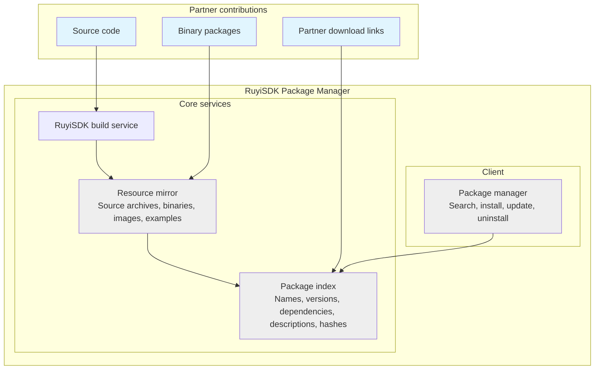

# RuyiSDK Partner Integration Guide

The RuyiSDK team welcomes partners who want to provide reliable development resources for the RISC-V ecosystem. This guide describes the available integration options and how to apply.

## 1. How Package Distribution Works

The RuyiSDK Package Manager gives RISC-V developers a single place to find and manage resources such as:

- Toolchains, including compilers, linkers, and debuggers
- Libraries, frameworks, and runtimes optimized for RISC-V
- Operating system images, firmware, and hardware drivers
- Profiling, simulation, verification, and testing tools
- Key applications ported to RISC-V
- Learning resources, including sample code, tutorials, and use cases

We prioritize resources directly related to RISC-V development. General-purpose tools without a specific RISC-V focus are better suited to other distribution channels. Contact us before applying if you are unsure whether a resource fits.



- The [package manager](https://github.com/ruyisdk/ruyi) runs on Linux on x86_64, aarch64, and riscv64. It can search, install, update, and uninstall packages. See the [supported platforms](./platform-support.md) for distributions including Debian, Ubuntu, openEuler, Fedora, Arch Linux, and Gentoo.
- The [package index](https://github.com/ruyisdk/packages-index/) is the authoritative source for package names, versions, dependencies, descriptions, and hashes. The client uses this metadata to locate and download each file.
- The [resource mirror](https://mirror.iscas.ac.cn/ruyisdk/) hosts the actual files, including source archives, precompiled binaries, system images, and examples. It supports several resource types and archive formats.

## 2. Integration Options

### 2.1 Build From Source

This option is for open-source RISC-V software projects. The RuyiSDK team builds and packages the software for distribution.

1. Provide the complete source code and describe any RISC-V-specific support or optimizations.
2. Authorize the RuyiSDK team to build the source and distribute the resulting binaries through its official channels.
3. The team cross-compiles, packages, and tests the software, following the project's requirements and your recommendations.
4. The team uploads the binaries to the official mirror and adds their metadata to the official package index.

This option is suitable for projects without an established distribution channel. Include build scripts or packaging guidance to help the team preserve the intended behavior of your project.

### 2.2 Distribute Prebuilt Binaries

This option is for RISC-V software with an established release process or whose source code is unavailable for distribution. Choose where to host your prebuilt binaries.

#### Option A: RuyiSDK Mirror

1. Provide tested binary packages and list their supported architectures and compatible distributions.
2. Authorize the RuyiSDK team to redistribute the packages.
3. The team uploads the files to the official mirror and runs basic compatibility checks.
4. The team publishes downloads through the official mirror and submits the metadata to the package index.

#### Option B: Partner-Hosted Downloads

You keep control of the binaries. RuyiSDK helps developers find and install them.

1. Give the RuyiSDK team public links to your packages.
2. Your servers must accept anonymous HTTP or HTTPS requests with the header `User-Agent: ruyi/<version>`, just as for `wget` or `curl`. Downloads cannot require interactive login or complex authentication.
3. The team adds package metadata and download links to the index. The package manager downloads the files directly from your servers.

As the host, you are responsible for maintaining the binaries and their metadata:

- Keep download URLs stable. Prefer versioned paths or content-addressed URLs that survive site and directory changes.
- Update the package index when releasing a new version. Keep version numbers, hashes, and changelogs accurate.
- If an unavoidable change breaks a link, open an issue or pull request to update the index within **48 hours**.
- Ensure the binaries work on the platforms and architectures you list. Update the compatibility information if those environments change.
- Choose this option only if you expect to maintain the package for at least **six months**.

You can submit package definitions directly to the [package index](https://github.com/ruyisdk/packages-index) by following its contribution guide. Consider updating the index automatically from your CI/CD release workflow.

## 3. How to Apply

### Step 1: Submit a Request

If you know which option you want and are familiar with GitHub, open an issue in the [package index](https://github.com/ruyisdk/packages-index) with the following information.

```markdown
## Resource Integration Request

### Basic Information
- Resource name:
- Current version:
- Project website or repository:
- License:
- Integration option: □ Build from source □ RuyiSDK mirror □ Partner-hosted downloads

### Technical Information
- Supported architectures: □ x86_64 □ aarch64 □ riscv64
- Supported distributions or environments:
- Resource type: □ Toolchain □ Library □ Development tool □ System image □ Other (specify)

### Details for the Selected Option

#### Build From Source
- Source repository:
- Build dependencies:
- Special build steps or considerations:
- □ I represent the rights holder and authorize the RuyiSDK team to build and distribute binaries from this source code.

#### RuyiSDK Mirror
- Package URL or delivery method:
- SHA-256 checksum:
- Tested platforms:
- □ I represent the rights holder and authorize the RuyiSDK team to redistribute these binaries.

#### Partner-Hosted Downloads
- Stable release URL pattern (may include a variable such as {version}):
- Packages for multiple architectures: □ Yes □ No
- □ The server accepts anonymous HTTP or HTTPS requests with a User-Agent header.
- □ I agree to the maintenance requirements and will keep the links available.

### Contact Information
- Name or team:
- Email:
- Other contact details (optional):
```

If you would like advice on your choice of distribution option or on whether a resource fits, email a short description of the resource to [contact@ruyisdk.cn](mailto:contact@ruyisdk.cn?subject=RuyiSDK%20Resource%20Integration). We will reply within three business days to help with the next steps.

### Step 2: Agree on Technical Details and Permissions

1. The RuyiSDK team reviews the request for relevance to RISC-V development and technical feasibility.
2. The partner provides the required authorization or written statement.
3. Both teams agree on the integration details.

### Step 3: Integrate and Publish

We integrate, test, and publish the resource using the chosen distribution option.

Partners using their own download servers can also fork the package index and submit a pull request directly. The RuyiSDK team prioritizes these contributions to speed up integration.

We look forward to working with you to expand the RISC-V development ecosystem.
