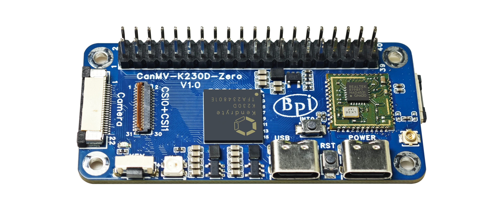
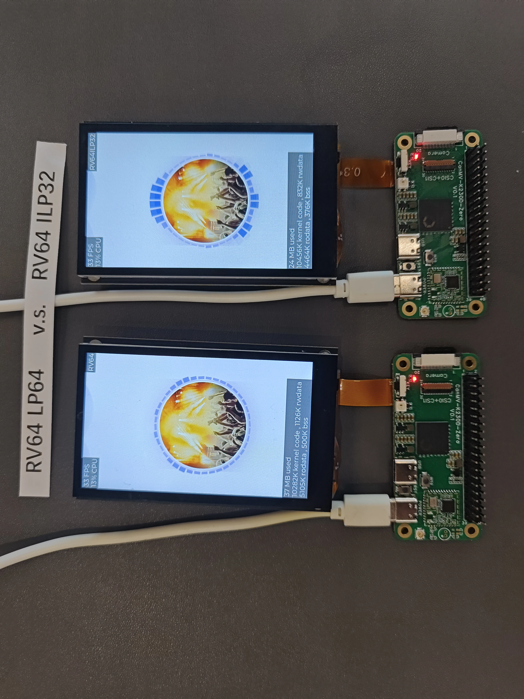

import ReactPlayer from 'react-player'
import useBaseUrl from '@docusaurus/useBaseUrl'

Im [vorigen Beitrag](https://mp.weixin.qq.com/s/argIGP4_rUKDm9IRIB-YTg) stellten das XuanTie-Team und PLCT Lab eine quelloffene Toolchain und einen Linux-Kernel für die neue 32-Bit-ABI vor. Der Canaan Kendryte K230D ist das erste Serienprodukt mit dieser ABI (RV64ILP32). Der im Vorjahr vorgestellte [K230](https://gitee.com/kendryte/k230_docs) basiert auf dem XuanTie C908 und war der erste 64-Bit-RISC-V-AIoT-Chip mit Vector 1.0. Beim stärker integrierten K230D ersetzen 128 MB Speicher im Gehäuse die bisherigen 256 oder 512 MB externen Speicher. Für diese Konfiguration benötigt LP64 zu viel Speicher. RV64ILP32 nutzt Arbeitsspeicher und Cache effizienter. Das gemeinsam entwickelte RuyiSDK **senkt den Speicherbedarf um 30 %** und **steigert die Leistung beim Durchlaufen verketteter Listen um 20 %** gegenüber dem LP64-SDK.



# RuyiSDK für den K230D

Das XuanTie-Team der DAMO Academy, Canaan und PLCT Lab am ISCAS haben RV64ILP32 auf das BPI-CANMV-K230D-Zero aus der Banana-Pi-Community gebracht und in RuyiSDK integriert:

- Linux 6.6 und eine aktualisierte Toolchain
- Neues 32-Bit-Root-Dateisystem mit LVGL
- Vektorbeschleunigung für Grafik
- Linux und NuttX mit Wechsel zwischen großem und kleinem Kern
- Wahl zwischen herkömmlicher 64-Bit- und neuer 32-Bit-Konfiguration

### Kernel-Konfiguration

| | Herkömmliches 64-Bit (RV64 LP64) | Neues 32-Bit (RV64 ILP32) |
| --- | --- | --- |
| Build-Befehl | `make ARCH=riscv k230_defconfig all` | `make ARCH=riscv k230_defconfig 64ilp32.config all` |

Die Standardkonfigurationen unterscheiden sich in zwei Zeilen:

```text
CONFIG_ARCH_RV64ILP32=y
CONFIG_32BIT=y
```

## Speichervergleich

Video und Bild zeigen LVGL im Vergleich. Links läuft die LP64-Variante, rechts ILP32.

<ReactPlayer playing controls muted={true} url={useBaseUrl('/video/news/blogs/2024-07-30-video_20240730_182451.webm', {forcePrependBaseUrl: true})} />



| Dynamischer Speicher | RV64 LP64 | RV64 ILP32 |
| --- | --- | --- |
| Belegt | **37 MB** | **24 MB** |

| Statischer Speicher | RV64 LP64 | RV64 ILP32 |
| --- | --- | --- |
| Kernel-Code | 10.282 KB | 10.456 KB |
| rwdata | 1.126 KB | 832 KB |
| rodata | 5.105 KB | 4.464 KB |
| bss | 500 KB | 376 KB |

Das neue 32-Bit-RuyiSDK nutzt den verfügbaren Speicher auf dem K230D effizienter.

## Leistungsvergleich

LP64-Zeiger sind doppelt so groß wie ILP32-Zeiger. Dadurch passen bei LP64 weniger in den Cache. Für den Vergleich lief auf dem K230D ein Test mit einer doppelt verketteten Liste.

### Traversierung einer doppelt verketteten Liste

Die Liste hat 4.000 Knoten und wurde jeweils 50.000-mal durchlaufen. Die fünf Einzelmessungen sind in Nanosekunden, der Mittelwert in Sekunden angegeben.

| ABI | Lauf 1 | Lauf 2 | Lauf 3 | Lauf 4 | Lauf 5 | Mittelwert |
| --- | --- | --- | --- | --- | --- | --- |
| LP64 | 3872221628 | 3420261850 | 3774494961 | 3539484998 | 4034940590 | **3,728280805** |
| ILP32 | 2614749257 | 2261891517 | 2680216665 | 2894499368 | 2847282036 | **2,659727769** |

Mit ILP32 lässt sich die Liste deutlich schneller durchlaufen.

## Weitere Informationen

- [K230D RuyiSDK auf GitHub](https://github.com/ruyisdk/k230_linux_sdk)
- [Systemabbild bauen (Chinesisch)](https://github.com/ruyisdk/k230_linux_sdk/blob/dev/README_zh.md)
- [Archivierte K230D-Anleitung (Chinesisch)](https://github.com/ruyisdk/docs/blob/2917dc89ca7a887aaab5e13fc8f7191158b696e7/k230d/intro.mdx)

# Ausblick

Frühere Ansätze für ARM, x86, MIPS und SPARC konzentrierten sich auf den Benutzermodus. Der neue Ansatz bringt auf Basis der RVA20-, RVA22- und RVA23-Profile **eine ILP32-ABI in den privilegierten Modus von RV64**. Im März 2024 erschienen Toolchain und Linux-Kernel dafür. Mit dem K230D erreicht die Technik erstmals ein Serienprodukt, benötigt 30 % weniger Speicher und nutzt den Cache deutlich besser. Wir freuen uns über Beiträge und Rückmeldungen zur Weiterentwicklung. Wir investieren weiter in Stabilität, Zuverlässigkeit und Leistung und laden Hardwarehersteller ein, gemeinsam an eingebetteten Systemen mit der neuen 32-Bit-ABI zu arbeiten.

## Über die beteiligten Teams

- [RuyiSDK](https://ruyisdk.org/de/) ist ein Open-Source-Projekt des [PLCT Lab](https://plctlab.org/en/). Es bündelt Werkzeuge zum Kompilieren, Debuggen und Emulieren und soll gängige RISC-V-Hardware unterstützen.
- Das XuanTie-Team der DAMO Academy entwickelt RISC-V-Prozessoren für unterschiedliche Leistungsklassen. Zusammen mit Partnern entwickelt es Chips, Werkzeuge, Betriebssysteme und Anwendungen für das offene RISC-V-Ökosystem.
- Canaan Inc. (NASDAQ: CAN) entwickelt leistungsfähige ASICs, Geräte für Blockchain-Anwendungen und KI-Chips. Das Unternehmen war weltweit das erste börsennotierte Blockchain-Unternehmen und der erste chinesische KI-Chipentwickler mit eigenem geistigem Eigentum an einer US-Börse. Canaan will Abläufe effizienter machen und den Alltag verbessern.
