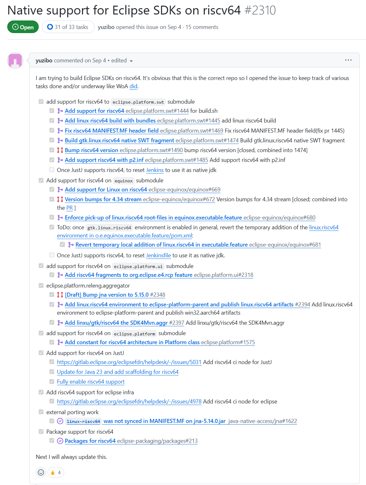
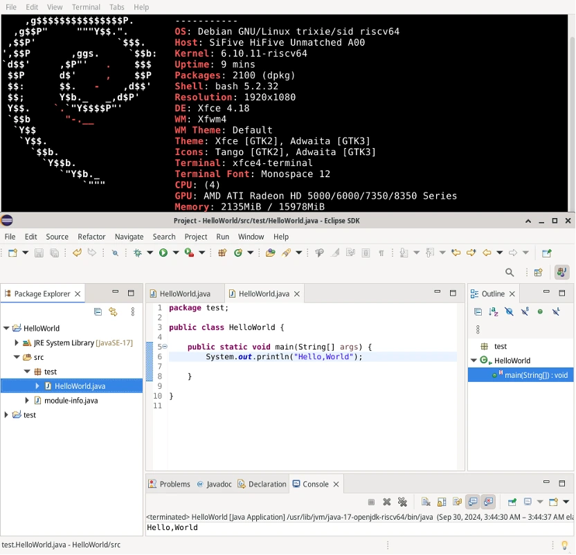

# Eclipse unterstützt erstmals RISC-V: Tägliche Builds zum Ausprobieren

> - [Originalartikel auf Chinesisch](https://riscv.org/blog-chinese/2024/09/eclipse-riscv64-support-upstreamed/)
> - Datum: 30. September 2024
> - Autorin: Chen Xuan (陈璇)

Eclipse ist eine quelloffene Entwicklungsumgebung (IDE), in der Entwickler Code in verschiedenen Sprachen schreiben, debuggen und verwalten können. Über Plug-ins lässt sie sich an unterschiedliche Anforderungen anpassen.

Das RevyOS-Team des Institute of Software der Chinesischen Akademie der Wissenschaften (ISCAS) hat gemeinsam mit anderen Open-Source-Entwicklern erste Unterstützung für riscv64 in das Eclipse-Projekt eingebracht. Dafür entstanden [mehr als zwanzig Issues und Pull Requests](https://github.com/eclipse-platform/eclipse.platform.releng.aggregator/issues/2310), unter anderem für SWT und Equinox. Damit lassen sich in Eclipse Java-Projekte mit OpenJDK auf riscv64 entwickeln.

*Abbildung 1: Viele Entwickler wirkten an der Anpassung der Eclipse-Komponenten mit.*

Die Änderungen sind in Eclipse eingeflossen. Wählen Sie auf der [Eclipse-Downloadseite](https://download.eclipse.org/eclipse/downloads/index.html) unter **Integration Builds** einen aktuellen Build. Die täglichen Builds unterstützen RISC-V seit dem 29. September 2024. Wählen Sie auf der Build-Seite **Eclipse SDK → Linux (64 bit version for RISC-V)**.

*Abbildung 2: Test des Eclipse SDK unter Debian auf einem SiFive Unmatched.*

Das RevyOS-Team arbeitet weiter an der riscv64-Unterstützung in Eclipse. Das ISCAS lädt Open-Source-Entwickler ein, sich daran zu beteiligen.

**Über das ISCAS und das RevyOS-Team**

Das RevyOS-Team gehört zum PLCT Lab am ISCAS. Das ISCAS ist Development Partner und Training Partner von RISC-V International und wurde im August 2024 als RISC-V Ecosystem Lab anerkannt.

**Besonderer Dank gilt diesen Mitwirkenden**

Yu Bo (于波), Chen Xuan (陈璇), Hannes Wellmann, Alexander Kurtakov, Ed Merks, Pawel Stankiewicz und Frederic Gurr.

*Falls jemand fehlt, wenden Sie sich bitte an die Autorin.*
