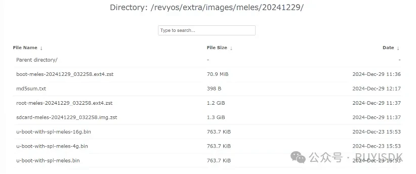
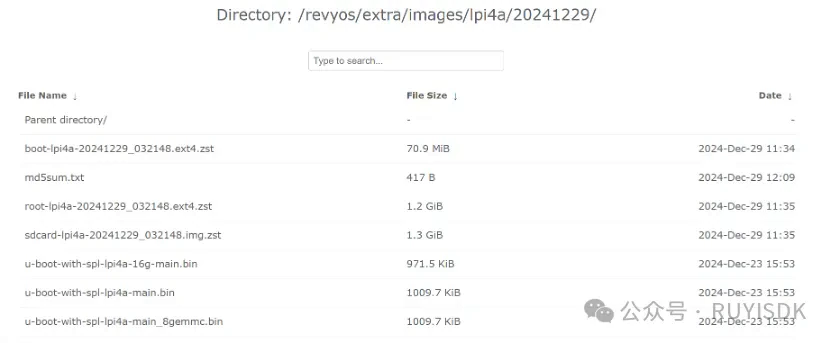

> - [Originalartikel auf Chinesisch](https://mp.weixin.qq.com/s/iVKqprdmaHCylPZAOyKigg)
> - Datum: 31. Dezember 2024
> - Autorin: Nie Yuting (聂雨婷)

Am 29. Dezember wechselte **RevyOS für den TH1520 von Linux 5.10 auf 6.6**. Damit erhalten Milk-V Meles und LicheePi 4A folgende Neuerungen:

- Regelung von CPU-Takt und Lüfterdrehzahl
- Unterstützung der Varianten mit 8 GB RAM für Milk-V Meles und LicheePi 4A
- Betrieb und Start von eMMC-Speicher
- Ethernet für eine stabile Netzwerkverbindung
- Bild und Ton über HDMI
- Unterstützung für das WLAN-Modul AP6256 nach dem Kernel-Update

RevyOS deckt damit Milk-V Meles mit 4, 8 und 16 GB sowie LicheePi 4A mit 8 und 16 GB ab.

[RevyOS für Milk-V Meles herunterladen](https://mirror.iscas.ac.cn/revyos/extra/images/meles/20241229/) (lässt sich auf SD-Karte schreiben).

[RevyOS für LicheePi 4A herunterladen](https://mirror.iscas.ac.cn/revyos/extra/images/lpi4a/20241229/) (lässt sich auf SD-Karte schreiben).

Die [offizielle RevyOS-Dokumentation](https://docs.revyos.dev/en/) enthält Anleitungen zum Erstellen von Debian-Paketen, zur GCC-Toolchain, zum Bauen von XuanTie QEMU und zum Kompilieren und Austauschen des Kernels.

###### Über den TH1520

Der TH1520 basiert auf dem XuanTie C910 und erreicht bis zu 2,5 GHz. Er bietet durchgängige Sicherheitsfunktionen, 4K-Videoverarbeitung, Ressourcen für heterogenes Rechnen und schnelle E/A. Damit eignet er sich für Anwendungen mit mittleren bis hohen Leistungsanforderungen. Wenn Sie der WeChat-Gruppe für Entwickler beitreten möchten, scannen Sie den QR-Code und geben Sie „TH1520“ an.

